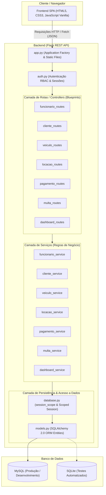
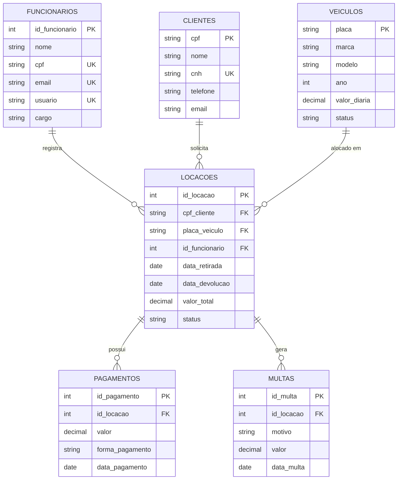

# Locadora de Veículos - Flask + MySQL

Sistema refatorado para Flask usando MySQL, pronto para visualizar e manipular os dados pelo MySQL Workbench.

## Arquitetura do Projeto

O projeto adota uma **Arquitetura em Camadas (Layered Architecture)** associada aos padrões **Application Factory**, **Service Layer** e **Unit of Work** (via SQLAlchemy ORM). Essa separação garante baixo acoplamento, alta coesão e facilidade de manutenção e testes.

### Visão Geral das Camadas



### Descrição dos Componentes

1. **Apresentação / Frontend (`frontend/`)**:
   - **Single Page Application (SPA)** implementada com HTML5, CSS3 moderno e JavaScript puro (Vanilla JS).
   - Comunicação assíncrona com os endpoints REST via `Fetch API`, enviando e recebendo payloads em formato JSON.
   - Gerenciamento de estado de tela, formulários modais dinâmicos e controle de sessão através de cookies seguros.

2. **Roteamento e Controle (`routes/`)**:
   - Organizado através de **Flask Blueprints**, particionando as rotas por módulo de domínio (`cliente`, `funcionario`, `veiculo`, `locacao`, `pagamento`, `multa`, `dashboard`).
   - Atua como Controller da aplicação: valida payload básico, extrai parâmetros, aplica autenticação/autorização e formata as respostas JSON com seus respectivos status HTTP.

3. **Regras de Negócio (`services/`)**:
   - Camada de isolamento de lógica de negócio (**Service Layer**).
   - Validações de domínio (cálculo de valor total de locação por diárias, restrições de datas, transição de status de veículos para `DISPONIVEL`/`ALUGADO`/`MANUTENCAO`, integridade de multas e pagamentos).
   - Mantém as rotas limpas e desacopladas dos detalhes de acesso ao banco de dados.

4. **Persistência e ORM (`database.py` e `models.py`)**:
   - Utiliza **SQLAlchemy 2.0** com modelo declarativo moderno (`Mapped[...]`, `mapped_column`).
   - Padrão **Unit of Work** implementado pelo gerenciador de contexto `session_scope()`, gerenciando transações com commit e rollback automáticos em caso de erro.
   - Suporte a pool de conexões (`pool_pre_ping`, `pool_recycle`) e provisionamento automático do schema e dados iniciais (seeding de administrador e catálogo de veículos).

5. **Segurança e Tratamento de Erros (`auth.py` e `errors.py`)**:
   - Autenticação baseada em sessão com cookies `HttpOnly` e `SameSite=Lax`.
   - Hashing seguro de senhas via `werkzeug.security`.
   - Controle de acesso baseado em papéis (**RBAC**) utilizando o decorator `@admin_required`.
   - Hierarquia customizada de erros (`ValidationError`, `NotFoundError`, `UnauthorizedError`, `ForbiddenError`, `ConflictError`) tratadas centralizadamente por interceptadores de erro do Flask.

### Modelo Entidade-Relacionamento (ERD)



### Estrutura de Diretórios

```text
locadora/
├── docs/                          # [NOVO] Entregáveis acadêmicos do Seminário II
│   ├── diagrama_mer.png           # Modelo Entidade-Relacionamento atualizado (6 tabelas)
│   ├── dicionario_dados.md        # Dicionário de dados no padrão exigido no roteiro
│   └── benchmark_explain.sql      # Consultas com EXPLAIN (antes e depois dos índices)
├── frontend/                      # Interface SPA (HTML5, CSS3, JS)
│   ├── index.html
│   ├── script.js
│   └── styles.css
├── routes/                        # Controllers / Blueprints REST
│   ├── cliente_routes.py
│   ├── dashboard_routes.py
│   ├── funcionario_routes.py
│   ├── locacao_routes.py
│   ├── multa_routes.py
│   ├── pagamento_routes.py
│   └── veiculo_routes.py
├── services/                      # [AJUSTADO] Camada de Serviços
│   ├── cliente_service.py
│   ├── dashboard_service.py       # Passa a consultar diretamente as Views SQL
│   ├── funcionario_service.py
│   ├── locacao_service.py         # Delega status e cálculos às Triggers/Procedure
│   ├── multa_service.py
│   ├── pagamento_service.py
│   ├── veiculo_service.py
│   └── utils.py
├── sql/                           # [NOVO] Rotinas avançadas e DDL do MySQL
│   ├── 01_schema.sql              # Script DDL das 6 tabelas (para documentação)
│   ├── 02_indexes.sql             # Índices de otimização (CREATE INDEX)
│   ├── 03_views.sql               # Visões gerenciais (CREATE VIEW)
│   ├── 04_procedures.sql          # Stored Procedures (fechamento e cálculo de valores)
│   └── 05_triggers.sql            # Triggers (mudança automática de status do veículo)
├── tests/                         # Testes automatizados (pytest)
│   └── test_locadora.py
├── .env
├── app.py
├── auth.py
├── config.py
├── database.py                    # [AJUSTADO] Executa os scripts de sql/ no MySQL
├── errors.py
├── models.py                      # [AJUSTADO] Mapeia tabelas + Views (somente leitura)
├── requirements.txt
└── README.md
```

## Recursos Avançados de Banco de Dados (BD2)

### 1. Índices de Otimização (`sql/02_indexes.sql`)
- `idx_veiculos_status`: Acelera a seleção de veículos com `status = 'DISPONIVEL'`.
- `idx_locacoes_status_data`: Índice composto para otimizar filtros de contratos ativos e ordenação por data de retirada.
- `idx_locacoes_cliente` e `idx_locacoes_veiculo`: Otimização de junções e histórico.
- `idx_clientes_nome`: Busca textual por prefixo de nome.
- `idx_pagamentos_locacao` e `idx_multas_locacao`: Indexação de chaves estrangeiras para acelerar junções e somatórios agrupados.

### 2. Visões Gerenciais (`sql/03_views.sql`)
- `vw_locacoes_detalhadas`: Unifica contrato, cliente, veículo, funcionário, total pago e multas sem redundância de agregação.
- `vw_veiculos_disponiveis`: Lista otimizada de carros prontos para nova locação.
- `vw_faturamento_frota`: Agrupamento gerencial de volume de contratos e faturamento por marca e modelo.

### 3. Stored Procedures (`sql/04_procedures.sql`)
- `sp_finalizar_locacao(IN p_id_locacao INT)`: Executa com garantia ACID o cálculo do total de diárias reais com base no valor unitário do veículo, soma todas as multas incidentes, atualiza o contrato para `FINALIZADA` e consolida o `valor_total`.

### 4. Triggers de Automação (`sql/05_triggers.sql`)
- `trg_locacao_after_insert`: Ao criar locação com status `ATIVA`, altera o veículo para `ALUGADO`.
- `trg_locacao_after_update`: Ao finalizar ou cancelar a locação (ou substituir o carro), sincroniza o status do veículo automaticamente (`DISPONIVEL` / `ALUGADO`).
- `trg_locacao_after_delete`: Libera o veículo caso a locação ativa seja removida.

### 5. Entregáveis Acadêmicos (`docs/`)
- [diagrama_mer.png](file:///c:/Users/pedro/Downloads/locadora/docs/diagrama_mer.png): Diagrama Entidade-Relacionamento visual de alta resolução.
- [dicionario_dados.md](file:///c:/Users/pedro/Downloads/locadora/docs/dicionario_dados.md): Dicionário de dados formal detalhando tipos, chaves, restrições e regras.
- [benchmark_explain.sql](file:///c:/Users/pedro/Downloads/locadora/docs/benchmark_explain.sql): Roteiro de testes de desempenho com `EXPLAIN` e `EXPLAIN ANALYZE` antes e após a aplicação dos índices.

## Banco de dados

O sistema usa MySQL por padrão. A configuração fica no arquivo `.env`:

```env
DB_HOST=localhost
DB_PORT=3306
DB_DATABASE=locadora
DB_USERNAME=root
DB_PASSWORD=
```

Se o seu MySQL tiver senha, preencha `DB_PASSWORD`.

O banco `locadora` é criado automaticamente na primeira execução quando `MYSQL_AUTO_CREATE_DATABASE=true`.

## Como rodar

Entre na pasta do backend:

```bash
cd locadora_backend
```

Crie e ative o ambiente virtual:

```bash
python -m venv .venv
.venv\Scripts\activate
```

Instale as dependências:

```bash
pip install -r requirements.txt
```

Inicie o servidor:

```bash
python app.py
```

Acesse:

```text
http://127.0.0.1:5000/app/
```

## Login padrão

```text
Usuário: admin
Senha: admin123
```

## O que já vem seedado

Na primeira execução o sistema cria:

- admin padrão;
- veículos iniciais.

Clientes, locações, pagamentos e multas começam vazios para você inserir pelo sistema.

## MySQL Workbench

No Workbench, conecte no seu servidor local MySQL e abra o schema:

```sql
locadora
```

As tabelas criadas são:

- funcionarios
- clientes
- veiculos
- locacoes
- pagamentos
- multas

## Testes

Os testes usam SQLite temporário apenas para validação automatizada, sem afetar o MySQL do sistema.

```bash
pytest
```
